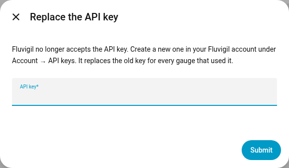

# Fluvigil for Home Assistant

Brings German water levels into Home Assistant, so a rising gauge can switch on a pump,
close a valve or send a notification — not just show a number.

## Why this and not one of the existing integrations

Home Assistant already ships an integration for the federal waterways, and a community
integration covers the sixteen state flood portals. Both are good, and for those gauges you
may not need this one.

What this adds is what neither has: **groundwater levels, reservoir storage, Swiss gauges and
published forecasts**, all in one place and one shape. And it does not scrape sixteen portals
inside your installation — when a state portal changes its layout, that is fixed once on the
server, not in a release you have to wait for.

## Install

Add this repository as a **custom repository** in HACS (category: Integration), then install
it and restart Home Assistant:

```
HACS → ⋮ → Custom repositories
Repository: https://github.com/informatJonas/fluvigil-homeassistant
Category:   Integration
```

## Setup

1. Create an API key at https://fluvigil.de → Account → API keys. Any tier works.
2. In Home Assistant: **Settings → Devices & services → Add integration → Fluvigil**.
3. Paste the key. An invalid key is rejected right there, not hours later.
4. Search for a gauge by name or water body and pick one. If Fluvigil has no value for it,
   the dialog says so and returns to the search.

You get a **Water level** sensor in centimetres above the gauge datum, with the measurement
time, the water body and the flood classification as attributes. Add the integration once per
gauge.

## Gauges without a value

Not every gauge Fluvigil lists comes with a value. Some providers do not allow their values to
be passed on — at the time of this release this concerns the gauges Fluvigil takes from the
flood portals of Bavaria and Baden-Württemberg — and a gauge can also be blocked or no longer
exist. In the setup dialog this reads *"Fluvigil currently provides no value for this gauge."*


## Replacing the API key

When Fluvigil rejects your key — revoked, expired, or because accounts were moved and old keys
stopped being valid — Home Assistant asks you to re-authenticate. Create a new key in your
Fluvigil account and enter it in any one of those requests: it is checked, written to **every
gauge that used the old key** on the same server, and the remaining requests disappear. Gauges
set up with another key or server are left alone. Entities, their ids and their history stay as
they are.

A revoked key is noticed within about an hour (immediately after a restart).



## How it behaves when things go wrong

- **Service unreachable:** the sensor becomes *unavailable*. It does not keep showing the
  last reading as if it were current — an automation would act on that.
- **No value for the gauge:** the sensor becomes *unavailable*, the log says so once, and the
  sensor comes back on its own when a value returns.
- **Key rejected:** the sensor becomes *unavailable* and Home Assistant asks you to
  re-authenticate, instead of carrying on without your account unnoticed.
- **Rate limit reached:** reported as such, so you know it is your tier's budget and not an
  outage.

## Update interval

15 minutes, on every tier. The upstream sources publish on a 15-minute raster, so polling
faster would fetch the same number twice. In addition each gauge checks the API key once an
hour, because the value request alone does not reveal that a key was revoked.

## License

MIT.
