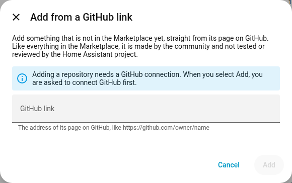
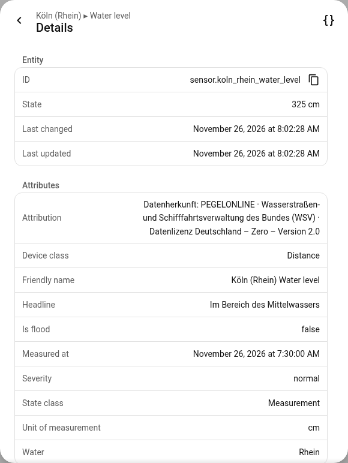
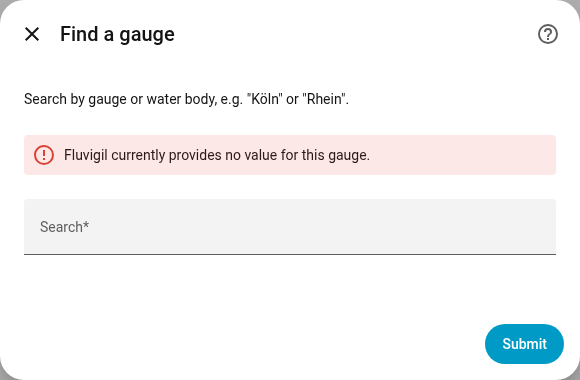

# Fluvigil for Home Assistant

Brings water levels from Germany and its neighbouring countries into Home Assistant, so a
rising gauge can switch on a pump, close a valve or send a notification — not just show a
number.

## Why this and not one of the existing integrations

Home Assistant already ships an integration for the German federal waterways, and a
community integration covers the German state flood portals. Both are good, and for those
gauges you may not need this one.

What this adds is **one source across borders**: besides Germany, Fluvigil carries gauges
from Austria, Czechia, Denmark, France, Luxembourg, the Netherlands, Poland, South Tyrol and
Switzerland, all in one shape. And nothing scrapes those portals inside your installation —
when one of them changes its layout, that is fixed once on the server, not in a release you
have to wait for.

<!-- ha-marketplace:exclude-start -->
## Install

Requires Home Assistant 2024.12.0 or newer.

### Home Assistant 2026.11 or newer: Marketplace

1. Open **Settings → Marketplace**. The first time, read and accept the notice about
   community content.
2. Select **Add from link** in the upper-right corner, enter
   `informatJonas/fluvigil-homeassistant` and select **Add**.
3. Adding a repository by link needs a GitHub account. If Home Assistant asks you to connect
   it, open <https://github.com/login/device>, enter the code Home Assistant shows and
   approve.
4. Open **Fluvigil** in the list and select **Install**, then **Install** again in the
   dialog.
5. Select **Set up**, or continue with [Setup](#setup) below.

A first installation needs no restart; after an update, restart Home Assistant when it asks
you to. If you installed this integration with HACS before moving to 2026.11, the
Marketplace takes it over and there is nothing to add again.

### Home Assistant before 2026.11: HACS

1. In HACS, open **⋮ → Custom repositories**.
2. Enter `https://github.com/informatJonas/fluvigil-homeassistant`, choose the type
   **Integration** and select **Add**.
3. Download **Fluvigil** and restart Home Assistant.
<!-- ha-marketplace:exclude-end -->

## Setup

1. Create an API key at https://fluvigil.de → Account → API keys. Any tier works.
2. In Home Assistant: **Settings → Devices & services → Add integration → Fluvigil**.
3. Paste the key. An invalid key is rejected right there, not hours later.
4. Search for a gauge by name or water body and pick one. If Fluvigil has no value for it,
   the dialog says so and returns to the search.

You get a **Water level** sensor in centimetres, with the measurement time, the water body
and the flood classification as attributes. Add the integration once per gauge.

The value counts from the reference level the provider uses. That is often the zero point of
the gauge, but some providers report a height above sea level (Swiss gauges, for example),
so choose the thresholds of your automations from the readings of that particular gauge.

## Source notice

The providers of the values attach conditions to them, such as a credit line and a licence.
Fluvigil sends this notice with the value and the sensor carries it as its **attribution**:
the short form where the provider allows one, otherwise the full text, and one line per source
where several are involved. Home Assistant lists it in the sensor's **details**. Dashboard cards
do not show it by themselves: if you display or pass on the values, for example on your own
dashboard or website, show the notice with them.

## Gauges without a value

Not every gauge Fluvigil lists comes with a value. Some providers do not allow their values to
be passed on — at the time of this release this concerns the gauges Fluvigil takes from the
flood portals of Bavaria and Baden-Württemberg — and a gauge can also be blocked or no longer
exist. In the setup dialog this reads *"Fluvigil currently provides no value for this gauge."*

## Replacing the API key

When Fluvigil rejects your key — revoked, expired, or because accounts were moved and old keys
stopped being valid — Home Assistant asks you to re-authenticate. **The sensors keep
reporting meanwhile**: the values are available without a key, within the limits for anonymous
access (600 requests an hour per IP address). A new key restores the limits of your tier.

Create the key in your Fluvigil account and enter it in any one of those requests: it is
checked, written to **every gauge that used the old key** on the same server, and the
remaining requests disappear. Gauges set up with another key or server are left alone.
Entities, their ids and their history stay as they are.

A revoked key is noticed within about an hour (immediately after a restart).

## How it behaves when things go wrong

- **Service unreachable:** the sensor becomes *unavailable*. It does not keep showing the
  last reading as if it were current — an automation would act on that.
- **No value for the gauge:** the sensor becomes *unavailable*, the log says so once, and the
  sensor comes back on its own when a value returns.
- **Key rejected:** Home Assistant asks you to re-authenticate and the log says so once. The
  sensor keeps reporting; it becomes *unavailable* only when the value itself cannot be
  fetched.
- **Rate limit reached:** reported as such, so you know it is your tier's budget and not an
  outage.

## Update interval

15 minutes, on every tier. The upstream sources publish on a 15-minute raster, so polling
faster would fetch the same number twice. In addition each gauge checks the API key once an
hour, because the value request alone does not reveal that a key was revoked.

## License

MIT.
